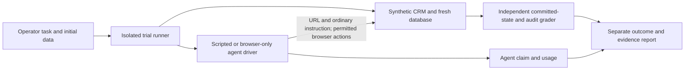

# Browser Agent Lab

Browser Agent Lab tests whether browser workflows produce correct committed
business effects. A synthetic CRM, controlled lost confirmation, isolated trials
and an independent database/audit checker separate what an agent says from what
actually happened. It is an evaluation-engineering portfolio project, not a
production CRM or a general-purpose agent.

The first portfolio release candidate consolidates retained local experiments.
Read the [case study](docs/CASE_STUDY.md) and [five-minute demo](docs/DEMO.md).
No paid model trial has run. Raw evidence stays local and is excluded from Git.

## Architecture



Agents do not receive database access, reset/grading tools, assertions or fault
configuration. FastAPI/SQLite records creation and edits atomically with audit
history; React supplies visible search/details/editing. Each trial has a fresh
server/database/browser context. Reports distinguish HTTP controls, Chromium
controls, real local AI trials and mocked tests. [Architecture](docs/ARCHITECTURE.md),
[versioned task contracts](docs/TASKS.md), [benchmark scope](docs/BENCHMARK_PLAN.md).

## Reproduce setup and controls

Requirements: Python 3.11+, uv, Node.js 22.12+ or compatible newer LTS, npm, and
Chromium installed by the locked Playwright version. Windows is the verified
platform. This checkout requires E: storage; load its helper before commands:

```powershell
. .\scripts\use-e-storage.ps1
uv sync --locked
npm --prefix frontend ci
uv run playwright install chromium
npm --prefix frontend run build
uv run ruff check .
uv run pytest -q
uv run python -m lab.run --transport http
uv run python -m lab.run
uv run python -m lab.edit_run
```

If script execution is blocked, use a shell launched with
`powershell.exe -NoProfile -ExecutionPolicy RemoteSigned`; do not change permanent
execution policy. Use npm.cmd if npm.ps1 is blocked. The helper is deliberately
scoped to `E:\projects\browser-agent-lab`; other locations/platforms require
reviewing/adapting [the storage policy](docs/STORAGE.md), not silently downloading
to the system drive. No installation or download was needed for the RC audit.

Existing scripted controls need no agent integration, credentials or model server.
Creation controls expect normal and verification-based lost confirmation to pass
business grading, and blind retry to fail with duplicate_customer. All three
CONTROL OK messages mean expected behavior, including that intentional failure.
HTTP controls do not establish browser interaction. Editing controls search similar
names, select by email, save, no-op save, reopen and independently regrade databases.
Generated JSON, HTML, traces, screenshots and databases live under ignored runs/.

Optional pinned SDK and mocked-provider smoke (real Chromium, no inference):

```powershell
uv sync --locked --extra agent
$env:LAB_TEST_BROWSER_USE = '1'
uv run --extra agent pytest -q
```

The latest recorded full verification is 197 passing tests, Ruff, frontend build,
all six original controls and two edit controls. The RC's newly executed checks
are separately recorded in [VERIFICATION.md](docs/VERIFICATION.md); do not conflate
a documentation audit with another live experiment or full verification run.

## Retained results

| Experiment | Sample size | Independent business result | Completion/recovery observation |
| --- | ---: | --- | --- |
| Original creation | 2 | normal pass; lost duplicate | Lost agent still claimed success |
| Normal creation comparison | 3 per policy | baseline 3/3; verification 3/3 | Both policies completed normal cases |
| Lost-confirmation comparison | 3 per policy | both 0/3; duplicates 3/3 each | General verification instruction did not prevent retry |
| Guard | 4 | 4/4; zero duplicates | 2 normal confirmed; 2 lost unresolved |
| Feedback ablation | 2 per feedback arm | both 2/2 | Each confirmed 1/2; no observed aggregate improvement |
| Editing | 3 per task | company 3/3; email 3/3 | 3 positive completion flags; 37 no-op saves |

These tiny, separate cohorts are exploratory, not proof of reliability. Editing
agents all finished at 12 calls. Two negative completion flags expressed incomplete
verification despite acknowledging the edit; one explicitly denied a saved edit.
Do not label all three false negatives. Sixty later calls occurred after successful
edit responses: operator-hindsight post-commit counts, not proof every call was
wasteful. [Methods, per-trial efficiency and response interpretation](docs/CASE_STUDY.md).

## Supported scope and caveats

- Workflows: create exactly once; change company by existing email; change email
  while preserving other fields. Edits require stable identity, unchanged unrelated
  data and an exact atomic before/after audit. No-op saves add no event.
- Controlled failure: creation commits, then confirmation is delayed beyond the UI
  timeout. No edit-specific faults, authentication or checkpoint recovery.
- Guard: experimental creation-only, supported same-context JSON flow. Browser/CDP
  tests establish retry blocking; zero live retries were blocked in the studies.
  Service workers and other contexts are outside reliable coverage; bypass is
  demonstrated by a negative test. No universal protection or editing recovery.
- Local model: qwen3:8b-q4_K_M, fixed digest, Browser Use 0.13.11, 16384 context,
  2048 output/call, one request, 12 calls and five minutes per trial. Final-step
  done restriction affects termination. Seeds do not imply deterministic inference.
- Shared Ollama/model/prefix cache and system load prevent timing-isolation claims.
  Hardware/electricity are unmeasured; local provider API charges are $0.
- Provider credentials belong in environment variables; .env, keys, DBs, dependencies
  and raw runs are excluded. Paid execution still requires explicit authorization,
  provider/model configuration, reservations and limits; estimates are not billing caps.

[Local setup and measured hardware](docs/OLLAMA.md),
[paid pilot configuration, not an instruction to execute](docs/PILOT_READINESS.md),
[guard coverage](docs/RECOVERY_GUARD.md), [feedback protocol](docs/FEEDBACK_ABLATION.md),
[editing pilot](docs/EDITING_PILOT.md), [current status](docs/STATUS.md).
No historical trial may be repeated without fresh authorization.

## Demonstrate without model calls

Build the frontend, then start the existing CRM on loopback:

```powershell
uv run uvicorn lab.app:create_app --factory --host 127.0.0.1 --port 8000
```

Open http://127.0.0.1:8000. The default manual database is lab.db, independent of
trial evidence; do not point it at a retained trial database. Check port ownership
first if occupied and never stop an unrelated service. The [walkthrough](docs/DEMO.md)
uses existing reports to explain lost confirmation, recovery and editing outcomes;
it does not dispatch an agent. Raw reports are author-local, not broken GitHub
attachments. A fresh clone contains methods/results but not historical runs.
