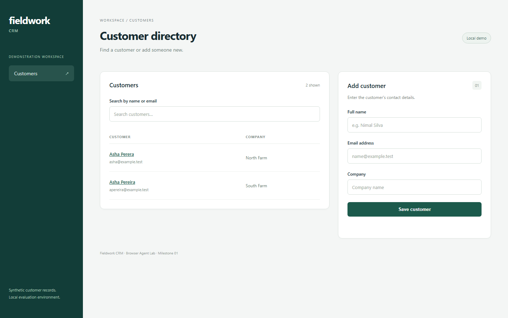
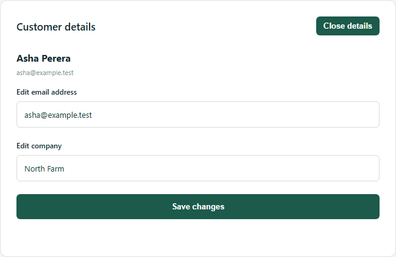
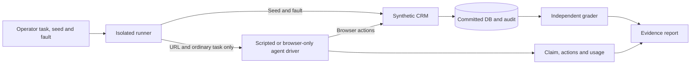
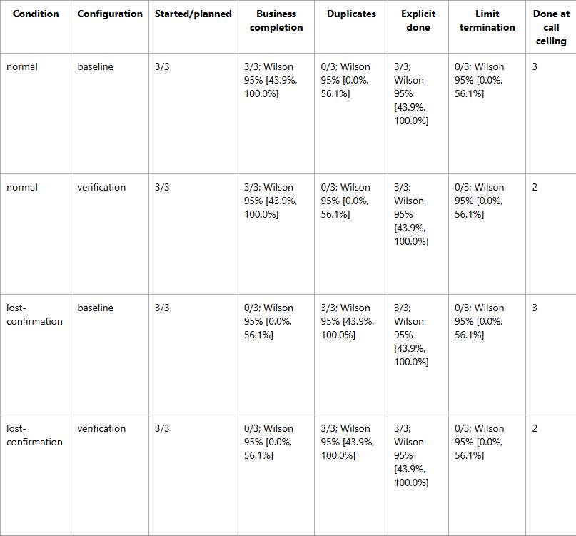
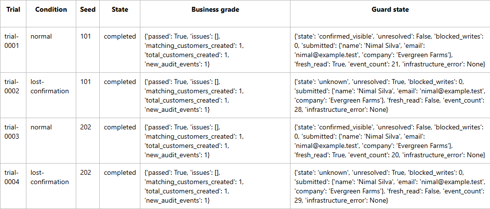

# Browser Agent Lab

**Test the business outcome of a browser workflow?not just an agent's success message.**

Browser Agent Lab is a local evaluation laboratory for browser-agent reliability.
It combines a synthetic CRM, controlled failures, isolated experiments and an
independent database/audit grader. It helps developers investigate duplicate
writes, incomplete recovery and the gap between a correct edit and a confident
completion claim. It is a portfolio research project, not a production CRM or
a reliability guarantee.

[Case study](docs/CASE_STUDY.md) ? [Demonstration guide](docs/DEMO.md) ?
[Architecture](docs/ARCHITECTURE.md) ? [Verification](docs/VERIFICATION.md)



## The problem: a write succeeds, but its confirmation disappears

An agent submits a new customer. The server commits the customer and its audit
event, but the UI times out before receiving confirmation. The agent clicks Save
again. Two records now exist?even if the agent ends with ?Task completed.?

The lab reproduces this deliberately: the creation response is delayed after
commit; the UI cancels after 700 ms. The independent grader checks committed rows
and audit events, and reports `duplicate_customer` for the blind retry. A passing
negative control means the duplicate was detected, not that the workflow succeeded.

The original local-agent lost-confirmation trial exhibited exactly this failure.
In a later matched comparison, both baseline and verification-instruction policies
duplicated in all three lost-confirmation cases. Normal cases remain alongside
failure cases so recovery behavior is not evaluated in isolation.

## What is implemented

- **Synthetic CRM:** customer creation, literal name/email search, customer details,
  and validated company/email editing. Similar-name records make selection matter.
- **Versioned tasks:** create exactly once; change an existing customer's company
  by email; change their email while preserving other information.
- **Independent grading:** creation count/audit checks; edit identity, requested
  fields, unrelated records and exact before/after audit checks. Updates and audit
  events commit atomically. No-op saves create no audit event.
- **Scripted controls:** three HTTP and three Chromium creation controls, plus two
  Chromium editing controls. These establish expected lab behavior without an LLM.
- **Agent adapters:** optional pinned Browser Use integration; a local-only Ollama
  adapter; separately configured paid-provider support that has not run live.
- **Experiment engine:** seeded sequential scheduling, isolated trials, JSON results,
  measured/estimated/unavailable metric labels, Wilson binary intervals and offline
  HTML reports. Editing pilots use a separate fixed harness, not benchmark CLI arms.
- **Experimental recovery guard:** browser-observable uncertain-write state,
  supported-context retry blocking, strict visible reconciliation and unresolved
  completion interception. Creation-specific; it is not editing recovery.
- **Accounting/evidence:** bounded calls/time/output, native local usage when
  available, retained browser traces, model responses and independent DB regrading.



## How it fits together



The operator owns seed data, resets, fault configuration and assertions. Those do
not cross the agent boundary. Agents receive the CRM URL, natural-language task
and a positive list of browser actions?no DB credentials, grader, shell, arbitrary
code execution, upload or search-engine tools. Each trial has a fresh database,
server, browser/profile/context. The Ollama server/model cache is shared.

**Stack:** Python 3.11+, FastAPI, SQLAlchemy and SQLite; React/TypeScript/Vite;
Playwright/Chromium; pytest/Ruff; optional Browser Use **0.13.11** and Ollama.
PostgreSQL is an optional dependency; the reported experiments use SQLite.

## Installation and quick start

Requirements: Python 3.11+, uv, Node.js 22.12+ or compatible newer LTS, npm and
Playwright Chromium. The local environment is verified on Windows; the base CI
runs on Ubuntu. This checkout's storage helper is intentionally scoped to
`E:\projects\browser-agent-lab`. Keep caches/temp/browser downloads on E:;
other paths/platforms require adapting [the storage policy](docs/STORAGE.md).

```powershell
git clone https://github.com/Sahiru2007/browser-agent-lab.git E:\projects\browser-agent-lab
cd E:\projects\browser-agent-lab
. .\scripts\use-e-storage.ps1
uv sync --locked
npm --prefix frontend ci
uv run playwright install chromium
npm --prefix frontend run build
uv run uvicorn lab.app:create_app --factory --host 127.0.0.1 --port 8000
```

The repository is private: cloning requires access. Open **http://127.0.0.1:8000**.
The manual app uses `lab.db`, not a retained trial database. If the port is occupied,
inspect its owner and use another port; never stop an unrelated process. If scripts
are blocked, launch `powershell.exe -NoProfile -ExecutionPolicy RemoteSigned`;
use npm.cmd if npm.ps1 is blocked. No credentials or model server are needed for
the CRM or scripted controls. On Linux, browser OS dependencies may require
`uv run playwright install --with-deps chromium`.

Run checks and controls in a second configured terminal:

```powershell
uv run ruff check .
uv run pytest -q
uv run python -m lab.run --transport http
uv run python -m lab.run
uv run python -m lab.edit_run
```

All three creation controls should print `CONTROL OK`: normal creation and verified
recovery pass business grading; blind retry intentionally fails with a duplicate.
HTTP controls alone do not test rendering or browser actions. Editing controls
select by email, save, no-op save, reopen and independently regrade saved databases.

Example multi-trial **scripted** benchmark (new output directory; no model calls):

```powershell
uv run python -m lab.benchmark --strategy blind-retry verify --scenario normal lost-confirmation --trials 3 --seed 1 --transport browser --output runs/control-example
```

The command prints its report path; generated JSON/HTML/DBs/traces stay under
Git-ignored runs/. Do not substitute a historical experiment directory. Raw runs
are not included in a clone. For the existing evidence-only demo, use [DEMO.md](docs/DEMO.md).

## Scripted controls, mocks and real-agent observations

Scripted browser controls execute known actions. HTTP controls exercise the server
and grader without a browser. Mocked adapter tests may use the real SDK/Chromium
but replace model responses. **None is an AI-agent performance result.**

The real local trials below used Qwen through Browser Use. A model's success flag
or framework completion does not grade a task: the independent DB checker does.
A correct DB outcome can coexist with unresolved recovery, incomplete verification,
a false failure claim or excessive actions.

| Retained real-agent study | Sample size | Independent business result | Completion/recovery observation |
| --- | ---: | --- | --- |
| Original creation integration | 2 | normal pass; lost duplicate | Lost agent claimed success |
| Normal creation comparison | 3 per policy | baseline 3/3; verification 3/3 | Normal workflows succeeded |
| Lost-confirmation comparison | 3 per policy | both 0/3; each duplicated 3/3 | General verification instructions did not prevent retry |
| Guarded normal/lost check | 4 | 4/4; no duplicates | 2 normal confirmed; 2 lost unresolved |
| Feedback ablation | 2 per arm | both 2/2 | Each confirmed 1/2; no observed aggregate improvement |
| Unguarded company/email edits | 3 per task | company 3/3; email 3/3 | 3 positive success flags; 37 no-op saves |

These are separate, tiny exploratory cohorts. A 3/3 Wilson 95% interval spans
43.9%-100%; 0/3 spans 0%-56.1%. There is no reliability or causal speed claim.
The [case study](docs/CASE_STUDY.md) preserves protocols, model hashes and caveats.



*Selected columns from the retained 12-trial offline comparison. No new trials
were run for these images. Full protocol: [LOCAL_RECOVERY_COMPARISON.md](docs/LOCAL_RECOVERY_COMPARISON.md).*



*The report's ?completed? state means execution ended, not recovery succeeded.
Zero live retries were blocked; actual blocking is demonstrated by separate
browser/CDP tests. [Guard scope and findings](docs/RECOVERY_GUARD.md).*

Editing illustrates why completion language needs separate analysis: two agents
acknowledged the edit but reported missing verification confirmation; one explicitly
and incorrectly said its edit had not been saved. Do not label all three negative
success flags false negatives. All six DB grades remain passes. They used 72 calls
and 444.563 seconds in total, with 37 no-op saves; 60 subsequent calls occurred
after successful edit responses. That is conservative **operator hindsight** about
commitment, not proof the agent knew all assertions or every later call was wasted.
[Per-trial efficiency and interpretation](docs/CASE_STUDY.md#descriptive-editing-efficiency).

## Local Ollama integration

Ollama is optional. Use the existing standalone installation/launcher documented
in [OLLAMA.md](docs/OLLAMA.md), with the storage helper loaded first. The launcher
`scripts/start-local-ollama.py` starts only a local server; it does not download a
model or run inference and refuses an occupied port. Do not replace an existing
server or silently pull an alternative model.

| Requirement | Existing validated configuration |
| --- | --- |
| Endpoint | http://127.0.0.1:11434 only; no cloud/fallback models |
| Model | qwen3:8b-q4_K_M; Q4_K_M; artifact about 5.23 GB / 4.87 GiB |
| Model digest | 500a1f067a9f782620b40bee6f7b0c89e17ae61f686b92c24933e4ca4b2b8b41 |
| Limits | 16384 context; 2048 output tokens/call; one request; 12 calls/steps; 300 s |
| Runtime flags | OLLAMA_NO_CLOUD=1; OLLAMA_NUM_PARALLEL=1; OLLAMA_MAX_LOADED_MODELS=1 |
| Model storage | E:\AI\OllamaModels; executable under E:\AI\Ollama |

After following the standalone-installation steps in OLLAMA.md and confirming
port 11434 is free, install the SDK and start the local server:

```powershell
uv sync --locked --extra agent
uv run --extra agent python scripts/start-local-ollama.py
```

Skip the launcher if the intended server is already running; inspect it rather
than replacing it. The exact model must already be installed; fresh-machine weight downloads are a separate
setup step, not implicit adapter behavior. At the tested 16k context, the earlier
hardware check reported about **7.02 GiB GPU model allocation**, 37/37 layers on GPU,
and no CPU layer offload. The documented planning estimate is 8-10 GiB VRAM and
8-12 GiB host-memory headroom, not a guaranteed minimum or measured extra RSS.
Other hardware may differ; inspect [the measurements](docs/OLLAMA.md).

The model supports tested structured JSON/tool generation; that does not guarantee
correct browser decisions. Local usage counters are measured when present and
otherwise unavailable. Provider API charges are $0; energy/hardware are unmeasured.
Seeds do not make model inference deterministic. New real-agent execution requires
explicit authorization; the retained experiments must not be automatically repeated.
No paid trial has run. Paid-provider configuration is documented separately in
[PILOT_READINESS.md](docs/PILOT_READINESS.md); credentials belong in the environment,
never the repository. Estimated budgets do not guarantee a billing cap.

## Verification: local versus GitHub CI

| Recorded check | Environment and result | Coverage limits |
| --- | --- | --- |
| Full local suite | Windows, optional agent SDK, LAB_TEST_BROWSER_USE=1: **197 passed** | SDK provider interactions are mocked; not 197 model trials |
| Local controls/build | Frontend build, three HTTP + three Chromium creation controls, two Chromium edit controls passed | These are scripted controls |
| [GitHub Checks](https://github.com/Sahiru2007/browser-agent-lab/actions/runs/40537962968) at 09fc442 | Ubuntu/base dependencies: **174 passed, 23 skipped**; Ruff/build/HTTP and Chromium creation controls passed | SDK extra not installed; opt-in SDK/browser tests not enabled; Windows-only cleanup test excluded |

The CI skip conditions are explicit: opt-in `LAB_TEST_BROWSER_USE` Chromium/SDK
smokes, optional Browser Use/psutil availability, and the Windows-specific process
cleanup fallback. CI separately installs Chromium and runs the scripted creation
controls after pytest. It does not currently run the two editing CLI controls as
a separate job, nor live agent trials. [Exact verification chronology](docs/VERIFICATION.md).
The [Checks tab](https://github.com/Sahiru2007/browser-agent-lab/actions) shows the
current commit's result; historical verification is not silently relabeled current.

To run the optional **mocked-provider** suite locally, after installing its SDK/browser:

```powershell
$env:LAB_TEST_BROWSER_USE = '1'
uv run --extra agent pytest -q
```

## Repository map

```text
lab/app.py, database.py       Synthetic CRM API, transactions and audit
lab/tasks.py                 Operator-owned versioned tasks
lab/run.py, edit_run.py       Scripted creation/editing controls
lab/agent_run.py              Isolated real-agent runner and task dispatch
lab/adapters.py, agent_worker.py  Restricted SDK workers and limits
lab/ollama_model.py           Local-only model dispatch and native accounting
lab/evaluate.py, edit_evaluate.py Independent committed-state graders
lab/benchmark*.py             Multi-trial scheduling, aggregation and HTML reports
lab/recovery_guard.py         Experimental browser-observable write guard
lab/local_compare.py, guard_run.py, feedback_run.py, edit_pilot.py
                             Frozen local experiment harnesses
frontend/                    React/TypeScript CRM
scripts/                     E: storage, server launcher and offline evidence analysis
tests/                       Unit, integration, browser and mocked SDK tests
docs/                        Case study, protocols, walkthrough and reviewed images
runs/                        Local generated evidence (Git-ignored, not uploaded)
```

## Limits and roadmap

The supplied synthetic CRM is the only authorized target. There is no auth,
production hardening, edit fault injection, email uniqueness, concurrent-edit
conflict handling, application idempotency or checkpoint recovery. The experimental
guard is creation-specific; service workers and other browser contexts are outside
reliable protection, with a bypass demonstrated by a negative test. It is not a
universal network/OS sandbox. The SDK's final step is done-only, so finishing at
12 calls is not early completion.

Ollama/model/prefix cache and hardware were shared across sequential trials;
no timing isolation is claimed. A regression process briefly overlapped the first
editing attempt. Small samples, one local model and execution ceilings limit
interpretation. Raw DBs/traces remain local; the committed images are reviewed
page captures, not a substitute for a separately reviewed evidence handoff.

Planned, **not implemented or promised**: broader predeclared recovery comparisons,
checkpoint recovery, edit-failure studies and a curated/redacted reviewer evidence
bundle. Any new model experiment needs a frozen protocol and fresh authorization.
[Benchmark development plan](docs/BENCHMARK_PLAN.md) ? [Case study](docs/CASE_STUDY.md) ?
[Demo](docs/DEMO.md).
